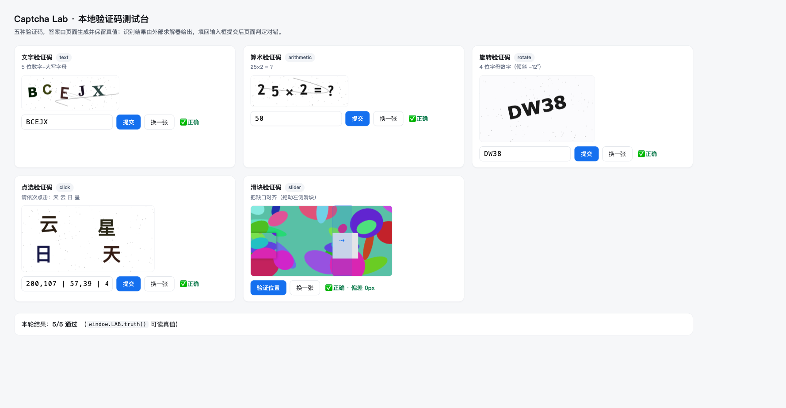

# captcha-solver — 给 agent 用的本地验证码插件

[](https://github.com/clawpaw-beep/captcha-solver/actions/workflows/test.yml)
[](LICENSE)
[](https://www.python.org/)

把验证码识别做成 agent 可以直接调用的工具：文字、算术、滑块、点选、旋转五类，
本地推理，不外传图片；识别不了的再按需上报远端服务。

插件以 **MCP server** 的形态提供能力，所以同一个后端可以挂到任何支持 MCP 的
agent（DSH、Claude Desktop、Cursor、自研框架），也可以当普通 HTTP 服务用。

## 工具面

在 DSH 里工具名会带命名空间前缀：`mcp__captcha__captcha_solve`、
`mcp__captcha__captcha_slider`、`mcp__captcha__captcha_click`、
`mcp__captcha__captcha_status`、`mcp__captcha__captcha_bench`。

| 工具 | 作用 | 关键参数 |
| --- | --- | --- |
| `captcha_solve` | 一次识别，返回要提交的 `answer` | `image_path`/`image_b64`/`image_url`、`kind`（含实验性 `arith_multi`）、`charset`、`length`、`prompt` |
| `captcha_slider` | 定位滑块缺口，返回 `drag_distance` | `background_path`+`piece_path`（或单张 `image_path`） |
| `captcha_click` | 点选验证码，返回有序点击坐标 | `prompt`（页面上的提示语） |
| `captcha_trajectory` | 生成人性化拖拽/点击轨迹（缓动 + 变速 + 抖动 + 回弹） | `distance` 或 `points`、`seed`、`steps` |
| `captcha_status` | 报告当前可用的识别引擎 | — |
| `captcha_bench` | 跑合成语料基准，输出各类准确率与耗时 | `dir`、`count` |

统一返回结构（`captcha_solve`）：

```json
{
  "kind": "text",
  "answer": "G9DPM",
  "confidence": 96.7,
  "candidates": [{"text": "G9DPM", "score": 96.7, "support": 3, "variants": ["ddddocr@1x", "otsu", "raw_l"]}],
  "elapsed_ms": 812,
  "recommendation": "submit the answer"
}
```

`confidence < 55` 就别硬提交，刷新验证码重来或补 `charset`/`length` 提示——这比
在错误答案上重试更省时间。

## 引擎

三级流水线，按需叠加，每一级都产出候选、最后做加权投票：

1. **神经分类器**（ddddocr + onnxruntime）—— 文字/点选的主力，对常见验证码字体最稳。
2. **Tesseract 5 多配置集成** —— 12 组预处理变体（Otsu、自适应二值化、去干扰线、
   中值去噪、3 倍放大、锐化、反色、去斜）+ psm 7/8/13 组合，按置信度投票。
3. **字体模板匹配 + 字形分割** —— 用系统字体合成字形库做归一化互相关，
   对标准字体渲染的验证码是"作弊级"准确，也是 `charset` 很窄时的兜底。

滑块不看 OCR：用 **2-D 边缘归一化互相关（FFT 实现，纯 numpy）** 在背景上做多尺度
模板匹配，带尺度先验（piece 通常与背景 1:1）与左侧伪峰抑制；只有合成截图时改走
**局部方差平坦块检测**（二值连通域 + 形状过滤），找被挖走的那块矩形。

算术走**结构化解析**，不再依赖整串 OCR：笔画几何识别 `+ - =`（实心细条 vs 两段
细条 vs 十字交叉），字形模板读数字，`=` 位置把尾巴的 `?` 直接切掉；再和"算子切分
（几何定算子、OCR 读两侧数字）"、"`=` 左侧裁剪整串 OCR"两条路线**互相印证**取最
可信的结果——`=?` 被读成数字这类错误就是靠这个消掉的。

算术的**求值**拆到 `expression.py`：真正的递归下降解析器，`+ -` 与 `* /` 分级、
支持括号与一元负号、内部用 `Fraction` 保证精确（`7/2` 输出 `7/2` 而不是 `3.5`）。
单运算符仍走原来的严格整串匹配（`a op b` 才认），因为 `solve_arithmetic` 的
**跨路线投票**正是靠这种严格性起作用的；只有当一次读数里真的出现 ≥2 个运算符时，
才由 `ocr.eval_chain` 接管，按运算优先级求值。这样"支持 `10+3*3+8`"不会把
单运算符的仲裁逻辑放松掉：

```python
>>> ocr.eval_arithmetic("10+3*3+8答案是?")
{'expr': '10+3*3+8', 'answer': '27', 'operator': '+', 'operators': ['+', '*', '+'], 'operands': [10, 3, 3, 8]}
>>> ocr.eval_arithmetic("5+3=?")        # 单运算符：严格语义不变
{'expr': '5+3', 'answer': '8', 'operator': '+'}
```

`arith.py` + `symbols.py` 是**实验性**的结构化算术引擎（`kind=arith_multi`）：多阈值
扫描、斜线抑制 + 形态学重建、按字高分块、几何判 `+ - = *`、真图/合成图的真实成绩见
下面"多运算符算术"一节——它目前**没有**接入 `auto` 路由。

旋转用**全局角度扫描 + 逐位置投票**：投影方差给出的角度只有量级可信、符号不可信，
所以按 `±est±10°` 铺 6 个角度各做一次快速 OCR（只跑神经引擎 + 3 个 tesseract 变体），
长度按置信度加权投票选定，再逐字符加权投票出结果，最后在胜出角度上跑一次完整
流水线做收尾。

## 安装

```bash
cd .dsh-bundles/captcha-solver
./scripts/setup.sh                       # 建 .venv 并装 ddddocr/numpy/pillow
```

`scripts/setup.sh` 默认使用清华镜像；换源：

```bash
./scripts/setup.sh https://pypi.org/simple
```

Tesseract 是可选但强烈建议的兜底引擎：

```bash
brew install tesseract tesseract-lang
```

> 为什么单独建 venv：DSH 自带的 Python 带 hardened runtime（library validation），
> 加载不了 onnxruntime 的 `.so`。venv 用非 hardened 的解释器，这才有神经引擎；
> 没有 venv 时插件仍能跑，只是退化为 tesseract + 模板两级。

## 接入 DSH

已注册到当前 profile（`~/.dsh/profiles/desktop/cordis.patch.yml` 里的 `mcp-captcha`
条目），**重启 DSH 后**生效，之后 agent 会多出 5 个 `captcha_*` 工具。

工具 schema 只用 DSH 支持的子集（`type/properties/enum/items` + 注解），
已用 `assertSupportedJsonSchema` 校验通过；协议用换行分隔的 JSON-RPC 2.0，
与 `@modelcontextprotocol/client` 的 stdio 传输一致，已用该 SDK 实测握手 + 调用。

首次在别的机器/别的 profile 里安装：

```bash
# 1) 装依赖
cd <repo>/.dsh-bundles/captcha-solver && ./scripts/setup.sh
# 2) 把 bundle 加进 profile 的 package.json（dependencies + dsh.profile.bundles），
#    或者直接把 cordis.patch.yml 里的 insert 段合并到 profile 的 patch 文件
# 3) 重启 DSH
```

自检（不依赖 DSH）：

```bash
printf '%s\n' \
 '{"jsonrpc":"2.0","id":1,"method":"initialize","params":{"protocolVersion":"2025-06-18","capabilities":{}}}' \
 '{"jsonrpc":"2.0","id":2,"method":"tools/call","params":{"name":"captcha_status","arguments":{}}}' \
 | ./run.sh
```

## HTTP 用法（非 MCP 框架）

```bash
.venv/bin/python -m captcha_solver.service --port 8790
curl -s localhost:8790/health
curl -s localhost:8790/solve -d '{"image_path":"/abs/login.png","charset":"0123456789"}'
curl -s localhost:8790/slider -d '{"background_path":"/abs/bg.png","piece_path":"/abs/piece.png","handle_x":0}'
curl -s localhost:8790/click  -d '{"image_path":"/abs/click.png","prompt":"请依次点击：明 天 快 乐"}'
curl -s localhost:8790/track  -d '{"distance":185,"seed":7}'          # 人性化拖拽轨迹 + 自检
curl -s localhost:8790/track  -d '{"points":[[120,44],[300,88]]}'     # 点选轨迹（时序 + 落点偏移）
```

需要的话用 `CAPTCHA_API_TOKEN` 加 `X-Api-Token` 头做鉴权。

## 命令行

```bash
cd server
../.venv/bin/python -m captcha_solver.cli solve --image out/corpus/text_000.png \
  --charset 0123456789ABCDEFGHIJKLMNOPQRSTUVWXYZ --json
../.venv/bin/python -m captcha_solver.cli solve --image cap.png --kind slider \
  --background bg.png --piece piece.png --overlay out/slider_debug.png
../.venv/bin/python -m captcha_solver.cli solve --image cap.png --kind arith_multi --json
../.venv/bin/python -m captcha_solver.cli bench --count 8
```

## 准确率基准

合成语料（`bench/gen_corpus.py`，刻意加了字符旋转、干扰线、噪点、模糊）。

每类 12 张（60 张，调参用的主力集合，数字最保守）：

```
kind             acc     n      ms
arithmetic     83.3%    12    1310
click         100.0%    12    1090
rotate        100.0%    12    2489
slider        100.0%    12      13
text           91.7%    12    1325
OVERALL        95.0%    60    1245
```

> 换到 Python 3.14 + onnxruntime 1.31 后重跑过一遍，overall 仍是 95.0%；算术类那两张
> 错的是 `arith_007` / `arith_009`——OCR 把干扰笔画读成第二位数字（`41-18` 而非
> `13-18`），属于引擎版本的读法差异，不是求值逻辑的问题（求值见
> `tests/test_expression.py`）。

每类 6 张（30 张，最初那版语料，用来对比提升）：

```
kind             acc     n      ms          (before)
arithmetic    100.0%     6    1523          66.7%
click         100.0%     6    1222          83.3%
rotate         66.7%     6    2854          66.7%
slider        100.0%     6      13         100.0%
text           83.3%     6     822          83.3%
OVERALL        90.0%    30    1287          80.0%
```

复现：`../.venv/bin/python -m bench.run_bench --dir out/corpus12`
（报告写到 `server/out/bench_report.json`；`bench.gen_corpus --count 12` 重新生成语料）。
真实站点验证码多为标准字体、轻噪点，文字类通常明显高于这个数字；点选/旋转类受
艺术字影响更大。剩下的失败几乎都是"同形字"：`U/F`、`V/I`、`Z/2`、`J/1`、`0/O`
——这类只看一帧像素本身就有歧义，工程的正确做法是低置信度时刷新换一张，而不是
硬猜（返回里的 `confidence` 就是给这个决策用的）。

参数提示能明显救回准确率：`charset` 收窄到真实字符集（如
`0123456789ABCDEFGHIJKLMNOPQRSTUVWXYZ`）后，文字类从 66.7% 升到 75%，点选从
75% 升到 100%。不传 `charset` 时默认按"数字+大写"处理；小写验证码请显式传
`charset=0123456789abcdefghijklmnopqrstuvwxyz`。

## 真实站点实测

合成基准再高也只说明管线没写错，能不能打要看真图。抓了 **44 张真实验证码**（每个接口各一次、
低频率、不登录不提交）：

| 来源 | 类型 | 尺寸 | 数量 | 结果 |
| --- | --- | --- | --- | --- |
| `login.sina.com.cn/cgi/pin.php` | 5 位字母数字 + 波浪干扰 | 100×40 | 18 | 12/18 |
| `ssl.captcha.qq.com/getimage` | 4 位字母数字 + 3D 描边 | 130×53 | 18 | 10/18 |
| `account.chsi.com.cn/passport/captcha.image` | 中文算术「a+b*c 答案是?」 | 200×100 | 8 | **0/8** |

去掉 5 张人眼也无法确定的（`real_labels.json` 里标 `?`），**字母数字类 22/31 = 71%**，
中文算术 0/8。

复现：

```bash
# 图片放在任意目录，labels 是人工目视核对过的答案
../.venv/bin/python -m bench.real_eval --dir out/real --labels bench/real_labels.json
```

### 真实数据打出的三个问题（已修）

1. **单次推理不可信。** 同一张图，ddddocr 在 raw / 反色 / 2 倍锐化 / Otsu 下的读法会不一样，
   一张图只跑一次就下结论等于抽签。现在跑 8 个变体 + beta 模型（第二套网络），共 9 个读数进池子。
2. **置信度是假的。** 之前 ddddocr 每次都报 82%，错的也报 82%。现在置信度由证据强度算：
   变体一致率 × 长度一致性 × 是否有第二个引擎印证，`variant_agreement` / `length_consensus`
   / `corroborated` 三个字段都返回，agent 可以据此决定提交还是换图。
3. **少读一个字符比读错更常见。** 加了一条规则：若某读法只是"比最优读法多插了一个字符"、
   且有 ≥3 次独立支持、置信度不低 20% 以上，则优先采用——`CDG` / `CDGE` 这种就是靠它纠正的
   （QQ 那批里改对 1 张，且不再误改其他）。

剩下 9 张全是同形字：`A/4`、`n/H`、`7/Z`、`d/C`、`E/3`、`K/X`、`N/M`、`c/S`。
这类在人眼放大 6 倍后也要反复看，属于模型能力边界，不是管线 bug。

## 多运算符算术（新增）

`kind=arith_multi` 是结构化引擎（`arith.py`），为"一串数字 + 图形运算符"的题准备的。
管线：多阈值扫描（`otsu` / `+35` / `+70`，选解析成功且置信度最高的那轮）→ 多角度
游程滤波删斜线（`imageops.slant_mask`）→ 腐蚀 + **形态学重建**（`reconstruct`：粗核长回
细笔画，1px 线和椒盐点没有粗核所以永远不出现）→ 小连通域过滤 → 用连通域自身高度估
字高与行带 → 分块（列零点优先，粘连块再按字高切）→ 逐块分类（`-` `=` `+` 用几何、
`*` 用星形填充率/长直游程/中心密度、其余交模板+OCR 投票、都不像就判 CJK 并截断）。

每块都带证据，最终返回：

```json
{"kind": "arith_multi", "text": "742+26727", "expr": "742+26727", "answer": "27469",
 "confidence": 82.6, "threshold": 172.0,
 "routes": [{"route": "columns", "chars": "71+419821162", "conf": 71.8, "parsed": true}, ...]}
```

读不出时 `answer` 是 `null` 并附 `variants`（每个阈值的读法），不会编一个答案出来。
合成语料 `arith_multi`（`Verdana`/`Trebuchet`/`Baskerville`/`Tahoma` 渲染——刻意选
模板库**没有**的字体、画六角星当 `*`、加中文后缀和椒盐/斜线干扰）目前 **0/12**；
真图学信网 **0/7**。原因见下一节，这是诚实的现状，不是没跑。

### 中文算术（学信网）：求值已解决，读图仍未解决

那 8 张是「10+3*3+8 答案是?」这种**阿拉伯数字 + 图形运算符 + 中文后缀**，带密集椒盐
噪点、斜向/竖向干扰线和紧贴的字距。真值已人工 6x 放大核对，写进
`bench/real_labels_arith.json`（`chsi_7` 不是算术题，是「2Rqv」这类字母验证码，排除）。

今天把能确定解决的部分解决了，剩下的如实记在这里：

| 环节 | 状态 | 证据 |
| --- | --- | --- |
| 表达式求值（含 `*` 优先级） | ✅ 已解决 | `10+3*3+8`→27、`7+9*4+7`→50、`8*4*0+5`→5…… 7/7 正确，`tests/test_expression.py` |
| 中文后缀识别（用「答案是?」定位切分） | ⚠️ 部分 | `arith.py` 能判出 CJK 块并截断，但对紧贴+噪声会误判 |
| 数字识别（衬线体、未知字体） | ❌ 未解决 | 模板库与站点字体不匹配，NCC 上界只有 ~0.5，判别力不足以定位 |
| `+` / `*` 图形运算符 | ⚠️ 部分 | `symbols.py` 合成模板定位，真 `+` 得分 0.86~0.97、`4` 误报 0.77，靠 0.8 阈值分开；`*` 六角星在紧贴时漏检 |
| 字符分割 | ❌ 未解决 | 字距 1~2px 且噪点填缝，列投影没有干净谷，等宽切分又会切进字内 |

真图实测（`python -m bench.real_eval --dir out/real --kind arithmetic`）：

```
accuracy: 0/7 = 0.0%
chsi_1.jpg  got 63    truth 27  read='111-48'
chsi_2.jpg  got 172   truth 50  read='171+1'
chsi_5.jpg  got 14    truth 18  read='2+12'
chsi_8.jpg  got -144081 truth 5 read='80-144161'
```

读错的是**字符级**的（`10+3*3+8` 被读成 `111-48`），不是求值错的。诚实的结论：

* 这类图靠"换预处理参数"不行。斜线抑制 + 形态学重建（`imageops.reconstruct`）能把
  噪点和 1px 线清掉，但字形先验（字体）和分割先验（字距）都没有，纯启发式到头了。
* 正确做法是**拿标注数据训一个识别模型**：学信网每次刷新都给一张新题，抓几百张 +
  用"提交答案对错"当弱标签就能自举，或人工标 200~300 张微调一个小 CRNN。
  这一步需要站点侧采样和标注预算，属于下一个迭代，不是本地调参能补的。
* 在那之前：`kind=arith_multi` 会返回 `answer: null` + 每路读法（`routes`），
  让 agent 知道"这题读不出、该换一张"，而不是拿一个假置信度去提交。
* `providers.py` 的远端逃生通道对这类图是更现实的兜底（支持中文的远端求解器）。

## 浏览器实测（`bench/lab/`）

`bench/lab/index.html` 是一个本地验证码测试台：五种验证码都由页面自己画出来，
真值留在 `window.LAB.truth`，提交后页面自己判定对错。任何浏览器 agent 都能拿它
做闭环验证。

```bash
cd server/bench/lab
python3 -m http.server 8811 --bind 127.0.0.1 &     # 测试台页面
python3 sink.py &                                   # 可选：接收 canvas 原始像素
# 打开 http://127.0.0.1:8811/index.html
```

agent 侧一轮闭环（已实测 4 轮 × 5 类 = 20/20 通过）：

1. **取图**：`canvas.toBlob()` → POST 到本地 sink 落盘，或 `toDataURL()` 取 base64；
   非 canvas 的 `` 验证码直接取 `src`/`fetch` 成 base64。
2. **识别**：`captcha_solve` / `captcha_click` / `captcha_slider` 拿答案。
3. **回填**：文字/算术/旋转填输入框；点选按返回坐标 `dispatchEvent(new MouseEvent('click', ...))`；
   滑块按 `drag_distance` 分 20~30 步发 `pointerdown/move/up`（别瞬移）。
4. **判定**：页面读 `#v-*` 或 `window.LAB.results`。

```json
// 第 4 轮实测（真值 → 识别）
{"text":"BCEJX","arith":"25×2=50","rotate":"DW38(-12°)","click":"天云日星","slider":"gapX=185"}
{"text":"BCEJX","arith":"50","rotate":"DW38","click":[[201,107],[58,39],[46,108],[190,46]],"slider":185}
→ 5/5 通过（滑块偏差 0px）
```



两条踩过的坑，接其他站点时同样适用：

* **别用无障碍节点的 box 截图当验证码**。MCP 的 `take_screenshot(uid=...)` 拿到的
  区域比 canvas 实际尺寸大且偏移（实测 442×158 vs 画布 220×78），裁出来会带进
  相邻卡片的内容，识别直接崩。canvas 用 `toBlob/toDataURL` 拿原始像素，``
  用 `src`，两者都精确。
* **滑块距离是 CSS 像素**。截图若带 `devicePixelRatio`（这里是 2.0），从图里算出的
  offset 要先除以 DPR 再拖动；否则会多拖一倍。

## 行为轨迹（新增：`captcha_trajectory`）

上一节结尾那条教训——"位置对了不代表过，脚本化拖动会按轨迹打分被判失败"——现在落成了
代码。`behavior.py` 只做一件事：把"像人"变成可复现的参数。

```python
from captcha_solver import behavior

track = behavior.drag_track(185, seed=7)
track["points"][:3]        # [{'x': 0.0, 'y': 0.0, 't': 0}, {'x': 38.06, 'y': -0.01, 't': 12}, ...]
track["durations_ms"][:8]  # [12, 11, 10, 11, 10, 9, 11, 13]
track["profile"]           # easing / steps / speed_range_ms / overshoot_px
behavior.humanize_check(track)
# {'ok': True, 'metrics': {'x_monotonic': True, 'duration_cv': 0.271,
#                          'uniform_risk': False, 'mean_ms': 14.9, ...}}
```

| 参数 | 默认 | 作用 |
| --- | --- | --- |
| `distance` | — | 目标位移（CSS px） |
| `steps` | 自适应 `max(12, min(40, d/8))` | 分几步走 |
| `easing` | `ease_out_quart` | `ease_out_cubic` / `ease_in_out_sine` 可选 |
| `jitter` | 0.6 | 亚像素抖动幅度（x 严格非减，末点精确等于 `distance`） |
| `overshoot` | True | 末端多拖 0.5~2.5px 再 2~3 步回弹 |
| `seed` | 随机 | 给定 seed 完全可复现 |

时间步长在 8~26ms 内变速（前快后慢），y 用两条低频正弦整条一次生成（回弹段不跳变，
幅度 ≤0.8px）。点选验证码用 `click_track(points)`：按压 60~140ms、点间移动 150~400ms、
落点前 2 步 micro-move、落点偏移 ±1.2px。

`humanize_check` 会把 README 里那条"等间距 12ms、零抖动"的机器轨迹判成
`uniform_risk: True / ok: False`，可以直接当回归基准。MCP 侧是 `captcha_trajectory`，
HTTP 侧是 `POST /track`（body 同上，返回里带自检字段）。

## 自测

```bash
cd server
../.venv/bin/python -m unittest discover -s tests -t . -v   # 46 条：表达式/形态学/符号/轨迹
../.venv/bin/python -m bench.run_bench --dir out/corpus12    # 合成基准
../.venv/bin/python -m bench.real_eval --dir out/real                      # 真图·字母数字
../.venv/bin/python -m bench.real_eval --dir out/real --kind arithmetic    # 真图·算术
```

## 实战：阿里云滑块（business.uniagency.net 登录页）

`https://business.uniagency.net/login` 的验证码是**阿里云验证码 PUZZLE 版**（`AliyunCaptcha.js`），
DOM 非常好认：

| 节点 | 含义 |
| --- | --- |
| `#aliyunCaptcha-img` | 背景图（data URL，296×200，缺口已画在图上） |
| `#aliyunCaptcha-puzzle` | 拼图块（data URL，52×200，**内容在 alpha 通道里**，位于条带 y=41~118） |
| `#aliyunCaptcha-sliding-slider` | 滑块把手，拖动距离 = 把手 `left` |
| `#aliyunCaptcha-sliding-text` | 状态文案（"Verification failed. Try again." 等） |

拿图 → 解偏移 → 拖拽，全程不需要账号：

```js
// 页面里：把两张 data URL 落到本地再解
const bg = document.getElementById('aliyunCaptcha-img');
const piece = document.getElementById('aliyunCaptcha-puzzle');
await fetch('http://127.0.0.1:8815/bg.png',    { method: 'POST', body: await (await fetch(bg.src)).blob() });
await fetch('http://127.0.0.1:8815/piece.png', { method: 'POST', body: await (await fetch(piece.src)).blob() });
```

```bash
../.venv/bin/python -m captcha_solver.cli solve --image bg.png --kind slider   --background bg.png --piece piece.png --overlay dbg.png
# 拖动距离(CSS) = offset × 显示宽度/图片宽度 − 拼图块在条带里的左偏移
```

实测两张挑战：

| 挑战 | 我们的 offset | 置信度 | 拖拽 | 站点结果 |
| --- | --- | --- | --- | --- |
| #1 山涧 | 233（真值≈235） | 100 | 236 CSS，等间距 12ms、无抖动 | **Verification failed** |
| #2 雪林 | 176 | 94 | 176.4 CSS，缓动 + 抖动 + 变速 | **通过**（弹窗关闭、站点继续走登录流程） |

为这张图踩的两个坑，已经修进代码：

1. **拼图块必须保留 alpha**。`load_image` 默认会把透明 PNG 压到白底，拼图块一旦压平就只剩
   一块含噪内容，shape 匹配无从谈起。现在 CLI / HTTP / MCP 取 `piece` 一律 `keep_alpha=True`。
2. **内容 NCC 会被纹理骗**。雪山那张背景里全是树干，内容相关性把缺口对到了树上（score 0.21，
   置信度 20.8——低置信度如实报出来了）。新增 `shape_offset()`：拿拼图块的 **alpha 轮廓**去匹配
   背景里"比周围更亮且低饱和"的缺口剪影，两张图分别给出 233 / 176，置信度 100 / 94.4。

行为侧结论：位置对了不代表过。第一次拖拽是等间距 12ms、零抖动的机器轨迹，被判定失败；
第二次换成缓动曲线 + 亚像素抖动 + 8~26ms 变速后通过。阿里云会按轨迹打分，脚本化拖动必须
把"像人"这件事做出来（或者用 CDP 的真实输入事件）。

## 实战：TikTok Ads 点选 + GeeTest v4 滑块（2026-11-01 真站实测）

两个目标都真跑了，结论不同，细节和现场图片在
[`server/out/live/REPORT.md`](server/out/live/REPORT.md)。

**TikTok Ads 点选（`Select 2 objects that are the same shape`）：通过 2/2。**
流程是 读 `img.src` 的 webp → 用 `imageops.components` 按饱和度分割物体（粘连块再按行
剖成"文字/几何体"两半）→ 视觉判断同形状的一对 → 按
`pointerover → move(3 段) → down → hold 80ms → up → click` 点选 → `Confirm`。
通过证据是弹窗关闭、登录请求打到服务端并返回
`We couldn't find an account with that email.` 第一次失败是因为坐标靠目视估计偏了 60px，
改用像素分割出的中心点后一次过——**点选类不要相信目测坐标**。

**GeeTest v4 滑块：用 CDP 真实输入后 4/4 通过。**（第一轮用 JS 合成事件是 0/1，见下） gt4 的背景图和拼图块是两张独立
PNG（300×200 / 80×80 RGBA），直接 `curl` 下来喂 `captcha_slider` 即可，没有 DPR 问题；
三张挑战分别给出 149 / 201 / 137，人眼复核缺口在 150 / 200 / 133，`shape_ncc` 可用。
第一轮用页面 JS 派发 `PointerEvent`，坐标对、轨迹对，仍然 `Please try again`——gt4 检查
事件的 `isTrusted`，合成事件过不去。

**第二轮换成 `Input.dispatchMouseEvent`（`captcha_solver/cdp.py` +
`tools/live_slider.py`），连续 6 次全部通过**，面板显示
`0.6 s. You beat 99% of users`：

```
run 1  gap 137 margin 10 drag 123.3px  → Verification Success
run 2  gap 116 margin 15 drag  97.4px  → Verification Success
run 3  gap 184 margin 10 drag 168.5px  → Verification Success
```

同时修掉一个系统性偏差：gt4 的拼图块是 80×80 RGBA，轮廓只占中间 56×61（**左边距 11~15px**），
匹配得到的是"轮廓该在的位置"，而滑块移动的是图片左上角，所以 `drag = gap_x − margin`。
上一轮直接拖 `gap_x`，正好差那 11px。

```bash
cd server
PYTHONPATH=. ../.venv/bin/python -m tools.live_slider --json   # 拉起带调试端口的 Chrome 并跑一遍
```

注意 headless 会被 gt4 直接拒绝，脚本默认带窗口；Chrome 用独立 profile，不影响日常浏览器。

## 逃生通道：远端求解器

本地置信度低时才上报，默认关闭：

```bash
export CAPTCHA_PROVIDER=http
export CAPTCHA_PROVIDER_URL=https://solver.internal/api/solve
export CAPTCHA_PROVIDER_KEY=YOUR_KEY
# 或打码平台
export CAPTCHA_PROVIDER=twocaptcha CAPTCHA_PROVIDER_KEY=YOUR_KEY
```

调用时带 `escalate: true`，返回里会出现 `escalated: true` 和 `local` 对照。
协议实现见 `server/captcha_solver/providers.py`。

## 目录

```
.dsh-bundles/captcha-solver/
├── cordis.patch.yml          # DSH bundle：把 MCP server 注册成 agent 工具
├── package.json              # bundle 元数据（dsh.bundle.patch）
├── run.sh                    # 选解释器启动 MCP server
├── scripts/setup.sh          # 建 venv、装神经引擎
└── server/
    ├── captcha_solver/
    │   ├── imageops.py       # 纯 numpy 图像原语：二值化/去线/去噪/去斜/连通域/2-D NCC
    │   │                     #   + reconstruct/erode3/drop_small_components/slant_mask/column_runs
    │   ├── ocr.py            # tesseract 驱动、字符混淆修复、多引擎投票、算术求值
    │   ├── expression.py     # 递归下降表达式解析（优先级/括号/Fraction 精确值）
    │   ├── arith.py          # 实验性：多阈值 + 形态学清洗 + 分块 + 符号分类（kind=arith_multi）
    │   ├── symbols.py        # 图形运算符定位：+ * - = 的合成模板 NCC + 几何复核
    │   ├── behavior.py       # 人性化轨迹：缓动/变速/抖动/回弹 + humanize_check 自检
    │   ├── cdp.py            # 最小 CDP 客户端：真实（isTrusted）鼠标输入、launch/connect/drag
    │   ├── text_solver.py    # 文字/算术：预处理集成 + 投票
    │   ├── template.py       # 字体模板库与逐字形识别
    │   ├── slider.py         # 滑块：2-D 边缘匹配 + 平坦块缺口检测
    │   ├── click.py          # 点选：检测框 + 逐字识别 + 全局指派排序
    │   ├── rotate.py         # 旋转：投影角度 + OCR 置信度二次搜索
    │   ├── engine.py         # 神经引擎适配（ddddocr，可选）
    │   ├── providers.py      # 远端兜底
    │   ├── pipeline.py       # 路由、升级轮次、统一返回
    │   ├── service.py        # HTTP API
    │   └── mcp_server.py     # MCP stdio JSON-RPC
    ├── bench/
    │   ├── gen_corpus.py     # 合成六类验证码（含 arith_multi）+ labels.json
    │   ├── real_eval.py      # 真图评估（--kind arithmetic 支持表达式+答案标签）
    │   ├── real_labels.json  # 字母数字真值（人工核对）
    │   ├── real_labels_arith.json  # 学信网算术真值（人工核对）
    │   └── run_bench.py      # 准确率/耗时基准
    ├── tools/
    │   └── live_slider.py    # 真站滑块闭环：读图 → slider → behavior → CDP 真实拖动
    └── tests/                # unittest：expression / 形态学 / 符号 / 轨迹 / 滑块透明边距
```

## 接进浏览器流程

agent 侧的典型闭环（配合浏览器 MCP 或 Playwright）：

1. 截图验证码元素 → `captcha_solve`（或 `captcha_click` 拿坐标）→ 填/点。
2. 滑块：截背景图 + 缺口图 → `captcha_slider` → 按 `drag_distance` 做人性化拖动
   （分 20~40 步、先快后慢、末端 3px 回弹），不要瞬移。
3. 失败就换一张：`confidence < 55` 或服务端拒绝时点刷新，不要连续重试同一张图。

## License

MIT —— 见 [LICENSE](LICENSE)。copyright (c) 2026 clawpaw-beep。

仓库里 `server/out/live/` 下的验证码样本是各站点公开发给匿名会话的挑战图（不含个人数据），
仅作回归 fixture 保留；`bench/lab/real_samples/` 同理。第三方字体、tesseract、ddddocr
分别遵循它们自己的许可，本项目只在使用层面依赖它们。
