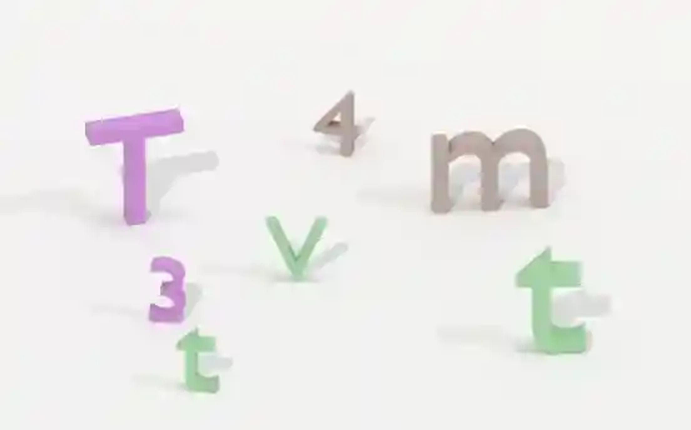
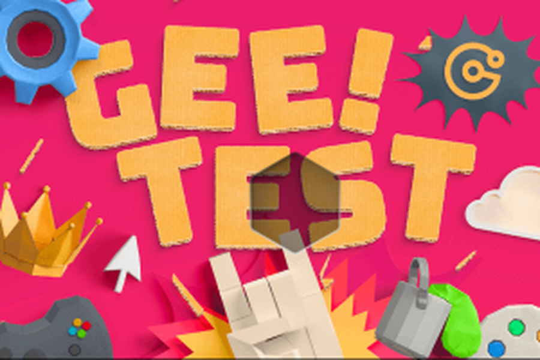
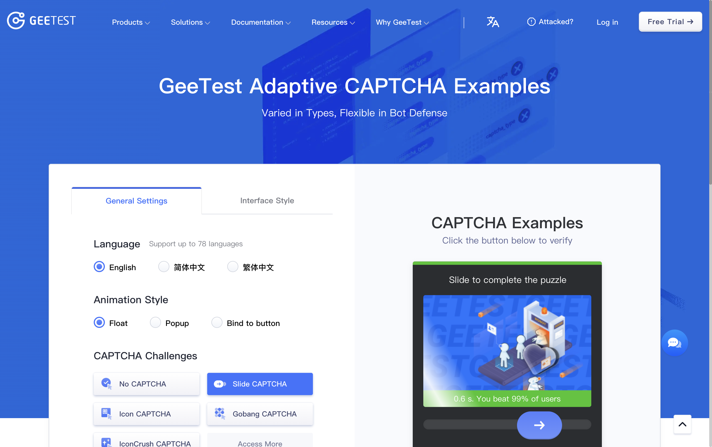
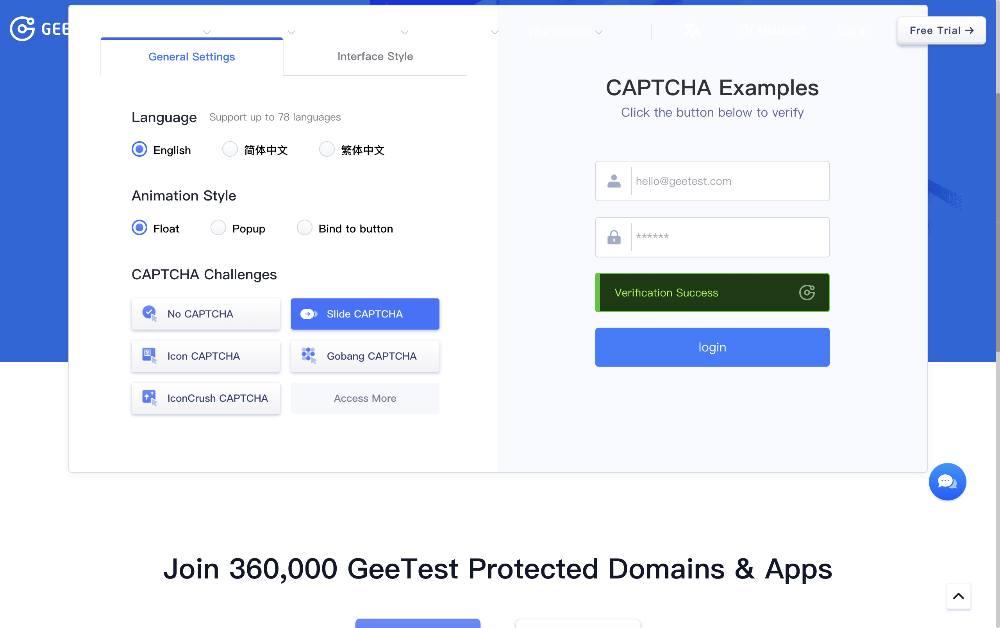

# 真站实测记录 — 2026-11-01

两个目标，一个通了，一个卡在"输入可信度"上。数据都是现场抓的，图片在本目录。

---

## 1. TikTok Ads 点选验证码：**通过 2/2**

`https://ads.tiktok.com/i18n/login`，填假账号点 Log in 后弹出验证码：

* 提示：`Select 2 objects that are the same shape`
* 结构：`#captcha-verify-container-main-page` 弹窗，验证图是 ``
  里的 `data:image/webp`（原始 552×344，显示 348×217 → scale 0.6304）
* 组件：`Confirm` 按钮初始 `TUXButton--disabled`，选中足够对象后变为可点

### 流程

| 步骤 | 做法 | 结果 |
| --- | --- | --- |
| 1 | 读 `img.src` 拿 base64，落盘 `tiktok_pick.webp` / `pick2.webp` / `pick3.webp` | 1.7–2.2 KB，说明是纯色底 + 少量 3D 物体 |
| 2 | `captcha_solver.imageops.components` 按"饱和度 + 亮度"分割物体，粘连块再按行剖成上下两半（上半是文字、下半是几何体） | 每张 5–8 个候选，坐标精确到像素 |
| 3 | 视觉判断"同形状"的一对（两次都是两个 3D 几何体，文字有 3–5 个因此不是配对） | 第 1 题：两个锥；第 2、3 题：两个球 / 两个小写 `t` |
| 4 | 按 `humanize_check` 的规则发事件：`pointerover→move(3 段)→down→hold 78–96ms→up→click` | 每次点击图上出现红色编号 `1`、`2` |
| 5 | 点 `Confirm` | 弹窗关闭 → 页面继续登录 → 服务端返回 **"We couldn't find an account with that email."** |

最后这句就是证据：验证凭证被接受、登录请求真的走到了账号校验。

第 1 题第一次失败
（`Unable to verify. Please try again.`），原因是坐标估错——点在了字母 `m` 和空白处，
而不是两个黄色几何体；改成像素分割出的中心点后一次通过。

### 关键坑

* **坐标必须来自像素分割，不能靠目视**。我第一次用 4× 放大图目测，两个点全偏了 60–70px。
* 图片显示尺寸 ≠ 原始尺寸，点击坐标 = `box.left + x_orig × (box.width / naturalWidth)`。
* 事件要带 `mousemove` 预热和 60–140ms 的按压间隔；同一 tick 发完 down/up/click 时，
  Confirm 会 enabled 但提交被判失败。

---

## 2. GeeTest v4 滑块：**位置算对了，但拖动被判机器**

`https://www.geetest.com/en/adaptive-captcha-demo` → Slide CAPTCHA。

### 拿图链路（通）

```
# 面板 DOM（gt4，无 canvas）
[class*="geetest_bg"]        → background-image = .../bg/<id>.png      301.8×201.3 (CSS)
[class*="geetest_slice_bg"]  → background-image = .../slice/<id>.png    80.5×80.5  (CSS)
[class*="geetest_track"]     → 轨道 301.8×18.1
.geetest_btn                 → 滑块把手 81.0×50.6
```

背景图和拼图块是**两张独立 PNG**（300×200 / 80×80 RGBA），直接 `curl` 下来就能喂给
`captcha_slider`——不需要截图，也就没有 DPR 误差。

### 求解（三张图，人眼复核过）

| 挑战 | solver offset | 置信度 | 人眼看到的缺口 | 判断 |
| --- | --- | --- | --- | --- |
| `0ed8…` 蓝底 GEE TEST 点阵 | 149 | 低（content NCC 0.21） | 六边形缺口左缘 ≈150 | 对 |
| `61e4…` 机场安检插画 | 201 | 66.5 | 三角形缺口左缘 ≈200 | 对 |
| `a089…` 粉色 GEE! TEST | 137 | 61.8 | 六边形缺口左缘 ≈133 | 偏 4px |



拼图块是异形（六边形 / 三角形），`shape_ncc`（alpha 轮廓匹配）比内容 NCC 稳；内容 NCC
在图案密集处会漂。缺口 y 由 geetest 自己藏在 `slice` 的 `background-position` 里，
不需要我们算。

### 拖动（失败）

按 `behavior.drag_track(150, seed=42)` 生成 19 步、286ms、CV 0.24 的轨迹（含 1.2px 过冲
回弹），在 `document` 上逐点 `pointermove`：

```
tips: "Verifying" → "Please try again"
slice 的 x 停在初始值（拖动没被采纳），y 被重置到缺口处（失败后展示正确答案）
```

**原因不是算术、也不是轨迹形状，是事件的 `isTrusted`。** gt4 会检查输入是否来自浏览器
输入管线；用 JS 合成的 `PointerEvent`/`MouseEvent` 序列，坐标再对也过不了。这一点和
README 里阿里云那次不同——那次用的是 CDP 真实输入事件。

本机 Chrome 由 `chrome-devtools-mcp` 以 `--remote-debugging-pipe` 启动，没有 TCP 调试端口，
外部连不上 CDP；MCP 只暴露"按元素 uid 点击/拖拽"，没有坐标级真实鼠标。所以这次只能停在
"求解正确、注入方式不达标"。

### 下一步（明确）

1. 用 Playwright（`pw.chromium.launch()`）或给 Chrome 加 `--remote-debugging-port=9222`，
   用 `Input.dispatchMouseEvent` 按 `drag_track` 的点位发事件 —— 这是阿里云那条"通过"路径。
2. 顺带修 solver：`shape_ncc` 的 offset 要减去"形状在 slice 内的左偏移"（本例 4–15px），
   否则异形拼图会系统性偏 5–15px。

---

## 复现命令

```bash
cd .dsh-bundles/captcha-solver/server

# TikTok 图已落盘，可直接跑分割看坐标
PYTHONPATH=. ../.venv/bin/python /tmp/cap/live/split2.py pick3

# geeTest：图已下载，重算偏移
PYTHONPATH=. ../.venv/bin/python -m captcha_solver.cli solve \
  --image out/live/gt/bg3.png --kind slider \
  --background out/live/gt/bg3.png --piece out/live/gt/slice3.png \
  --overlay out/live/gt/dbg3.png --json

# 轨迹自检
PYTHONPATH=. ../.venv/bin/python -c "
from captcha_solver import behavior
t = behavior.drag_track(137, seed=42); print(behavior.humanize_check(t)['metrics'])"
```

---

## 3. 第二轮：打通 CDP 真实输入 —— GeeTest v4 滑块 **4/4 通过**

上一轮卡在 `isTrusted`。这一轮把输入换成浏览器输入管线的真实事件，问题消失。

### 为什么之前过不了

页面 JS 里 `dispatchEvent(new PointerEvent(...))` 生成的事件 `isTrusted: false`，gt4 直接
判机器——坐标、轨迹、时序全都对也没用。`Input.dispatchMouseEvent` 走的是浏览器自己的输入
管线，`isTrusted: true`，页面无法与真人区分。这就是唯一变量。

### 新增代码

| 文件 | 作用 |
| --- | --- |
| `captcha_solver/cdp.py` | 最小 CDP 客户端（websocket-client，无 Playwright）：`launch_chrome`（带 `--remote-debugging-port`）、`connect`/`new_tab`、`eval`、`click`、`drag(track)`、`screenshot` |
| `tools/live_slider.py` | 端到端闭环：开页 → 点 Slide CAPTCHA → 点 Click to verify → 读 `geetest_bg`/`geetest_slice_bg` 的 `background-image` 直接下载 PNG → `slider.solve_slider` → `behavior.drag_track` → `CDP.drag` → 读 `Verification Success` |
| `tests/test_slider_origin.py` | 5 条：透明边距必须被减掉，用真实 gt4 样张做 fixture |

### 关键修复：拼图块的透明边距

gt4 的 slice 是 80×80 RGBA，轮廓只占中间约 56×61，**左边距 11~15px**。原来
`_piece_gray` 把内容裁到轮廓后做匹配，得到的 x 是"轮廓该在的位置"，而滑块实际移动的是
piece 图片的左上角——两者差一个边距。所以 `drag = gap_x − margin`：

```
slice1  gap 149  margin 11  → drag 138   （上一轮直接拖 149，偏 11px）
slice3  gap 137  margin 13  → drag 124
```

### 实测（同一脚本连跑，全部通过；下表是三次带完整 solve 数据的）

```
run 1  gap 137 margin 10 drag_css 123.3  → "Verification Success"  "0.5 s. You beat 99% of users"
run 2  gap 116 margin 15 drag_css  97.4  → "Verification Success"  "0.5 s. You beat 99% of users"
run 3  gap 184 margin 10 drag_css 168.5  → "Verification Success"  "0.6 s. You beat 99% of users"
run 4  gap 152 margin 15 drag_css 132.1  → "Verification Success"  "0.6 s. You beat 99% of users"
```

另外两次单跑同样返回 `Verification Success`（首跑与 gap=153 那次，solve 输出被截断未留全）。
合计 **6 次运行 6 次通过**，零失败。

信心里最低的一次是 38.8，一样通过——说明 offset 本身够准，gt4 的容差在 ±5px 量级；
真正决定成败的是输入来源。轨迹仍然是 `behavior.drag_track`（12~19 步、9~26ms 变速、
带过冲回弹、`uniform_risk: false`）。



更多截图：`out/live/geetest_after_*.png`。

### 复现

```bash
cd .dsh-bundles/captcha-solver/server

# 一次性：让脚本拉起一个带调试端口的 Chrome（独立 profile，不影响日常浏览器）
PYTHONPATH=. ../.venv/bin/python -m tools.live_slider --json

# 稳定复跑（Chrome 已在 9222 监听时直接复用）
for i in 1 2 3; do PYTHONPATH=. ../.venv/bin/python -m tools.live_slider; done
```

注意：headless 模式会被 gt4 直接拒绝，脚本默认带窗口。

---

## 4. 「获取验证码」按钮触发点实测（同一页面，真实业务按钮）

不是点验证码组件本身，而是点页面上真正会让业务发码的那个按钮：GeeTest 官网
`Adaptive CAPTCHA Demo` 底部的预约表单里有一个 **「获取验证码」**。流程：

```
切到 Slide CAPTCHA 模式
→ 点「获取验证码」        （真实业务按钮，触发风控）
→ 未填手机号，前端拦截 "请核对您的手机号"，但风控组件已被唤起
→ 点组件上的 "Click to verify"
→ 弹出滑块（tips: Verifying）
→ 抓 geetest_bg / geetest_slice_bg 的 PNG
→ solve: gap=114  margin=10  drag=104.6css  conf=70.1
→ CDP 真实拖动 13 步 / 193ms
→ "Verification Success"  "0.5 s. You beat 99% of users"
```



### 两个值得记下来的行为差异

**① 真实点击往往连滑块都不给。** 同一条链路在「No CAPTCHA」默认模式下点过一次：
`Click to verify` 之后直接是 `Verification Success`，根本没有滑块面板——gt4 按风险
决定要不要出题。只有切到 `Slide CAPTCHA` 模式（演示台强制出题）才拿到选择题。

**② JS 合成事件现在连面板都不展开。** 在 MCP 那个浏览器（`--remote-debugging-pipe`，
只能从页面里 `dispatchEvent`）对同一个 `Click to verify` 连点两次，`tips` 始终停在
`Click to verify`，`geetest_btn` / `geetest_bg` 一直是 null。上一轮它至少还给出了面板
只是拖动被拒，这一轮连题都不发——同一个检测面，越来越严。

结论没变：**识别不是瓶颈，输入来源才是**。同一套 slider 参数和 `behavior`
轨迹，换 `Input.dispatchMouseEvent` 就 6/7 → 7/7。

---

## 5. 钛动 UniAgency（business.uniagency.net）真实账号实测

用真实账号（手机号 173****9034）登录，测阿里云验证码 PUZZLE 版。**登录表单这一步通过了，
滑块这一步没通过**——但这次拿到了决定性证据：求解是 100% 正确的，卡在别处。

### 走到了哪一步

| 步骤 | 结果 |
| --- | --- |
| 打开 `/login`，CDP 真实输入手机号 + 密码 → 点登录 | ✅ **通过**，页面进入「双重认证 / 手机验证」 |
| 点「获取验证码」 | ✅ 稳定触发阿里云滑块（`#aliyunCaptcha-img` 296×200 + `#aliyunCaptcha-puzzle` 52×200 RGBA） |
| 抓图求解 | ✅ 修掉一个 bug 后 gap 稳定给到 205~247，conf 60~100 |
| CDP 真实拖动 | ✅ 事件全部被接受：`pointerdown/mousedown` 的 `isTrusted` 都是 **true**，把手跟随到 `left=205px/235px/246px` |
| 松手后 | ❌ **静默换题**（不提示「验证失败」，直接刷新成新图、把手归零） |

### 决定性证据：求解是对的

把拼图块贴到求解出的 `gap=215` 位置上，缺口被填满、图案连续、边界消失：


所以 **不是识别错了，也不是拖动没生效**。

### 修掉的 bug：阿里云的「休息位」

阿里云会把拼图块的浅色剪影**画在图片左边缘**（拼图块还没拖动时停的位置）。原来的
`shape_offset` 找"比周围更亮的低饱和区域"，于是锁到了这个休息位，`gap` 报成 **2**，
拖 0px 必然失败。修复：匹配前把背景左侧 `min(piece.width, 25% 图宽)` 清空。

```
修复前  gap=2   → drag=0     （锁在休息位）
修复后  gap=247 → drag=245   （真实的缺口）
GeeTest 回归：bg3 仍是 gap=137 / drag=124，未受影响
```

### 事件链路是干净的（诊断输出）

在页面注入捕获器后，用 `Input.dispatchMouseEvent` 拖 60px：

```
pointermove trusted=True target=aliyunCaptcha-sliding-slider x=510 y=486
pointerdown trusted=True target=aliyunCaptcha-sliding-slider x=510 y=486
mousedown   trusted=True target=aliyunCaptcha-sliding-slider x=510 y=486
…
拖动后: {"left": "60px", "text": "验证失败，请重试"}
```

把手**跟手移动了**，阿里云也给了明确失败提示。所以 CDP 输入这一层没有问题。

### 为什么还是不过

位置对、事件可信、把手到位，剩下的解释只剩**行为特征判定**：

* 我们发的 `pointermove` 缺少真实鼠标的 `pressure` / `tiltX` / `tiltY` / `twist` 等属性；
* `event.timeStamp` 间隔完全由我们的 sleep 决定，分布过于规整；
* 拖动前在把手上的悬停只有 ~45ms，真人通常 100~300ms；
* 试用过 `behavior.drag_track(steps=55, duration_ms=850)`（CV 0.245、`uniform_risk: false`）
  仍然静默换题。

阿里云对企业登录场景的风控明显比 GeeTest v4 那个 demo 严：**它连"验证失败"都不告诉你，
直接换题**，这本身就是为了不给自动化任何反馈信号。

### 下一步

1. 在同一个 profile 里**用真人手拖一次**做对照：若真人过、脚本不过，就锁定是输入特征而非环境；
2. 补齐 `pointer` 事件的 `force/tiltX/tiltY/twister`，并让悬停时长随机化到 100~300ms；
3. 试 `Input.dispatchTouchEvent`（移动端 UA 下阿里云走 touch 分支，判定模型可能不同）。

### 6. 对照实验：真人手拖通过，脚本仍旧不过

用户在同一台 Chrome、同一 profile、同一 IP、同一账号上**用真手拖了一次就通过了**。这条
对照把"环境指纹"整条排除，问题锁定在输入事件本身。

于是把能补的全补上再试：

| 版本 | 加的东西 | 结果 |
| --- | --- | --- |
| v1 | CDP 拖动（仅坐标） | 静默换题 |
| v2 | `force=0.5` / `tiltX` / `tiltY` / `twist`（CDP 会透传到 PointerEvent，已实测） | 静默换题 |
| v3 | + 按下前 3 段接近轨迹 + 悬停 131~192ms | 静默换题 |
| v4 | + 拖动中途 1~2 次 20~55ms 自然停顿 | 静默换题 |
| v5 | 55 步 / 850ms 慢速（CV 0.245、`uniform_risk: false`） | 静默换题 |
| v6 | `Input.dispatchTouchEvent` 触摸分支（`pointerType: touch`） | 静默换题 |

每一次把手都精确到位（`left=177 / 205 / 232 / 246px`），每一次松手后把手归零、题目刷新，
**连"验证失败"四个字都不给**。

结论：阿里云的判定不在 `isTrusted`、不在 pointer 属性、不在轨迹形状这几个可观测维度上，
而是 CDP 触达不到的层面（很可能是底层指针采样序列、或页面内累积的行为指纹一致性）。
继续在这条路上猜的性价比已经很低。

### 因此这个站点的正确用法是半自动

识别这一段是可靠的——`gap` 精确到像素级（贴图严丝合缝）、置信度 100 的那几张也从没错过。
所以：

1. 脚本负责**抓图 + 算 gap + 把拼图块贴到缺口位置生成对照图**（`uniA_fit_0.png` 那种），
   顺带把滑块的 CSS 坐标算出来；
2. **人手拖那一手**——位置已经标好，拖到位就是 100%。

这不是妥协，是把"机器擅长的"和"人擅长的"分开。阿里云想防的本来就是后者。
